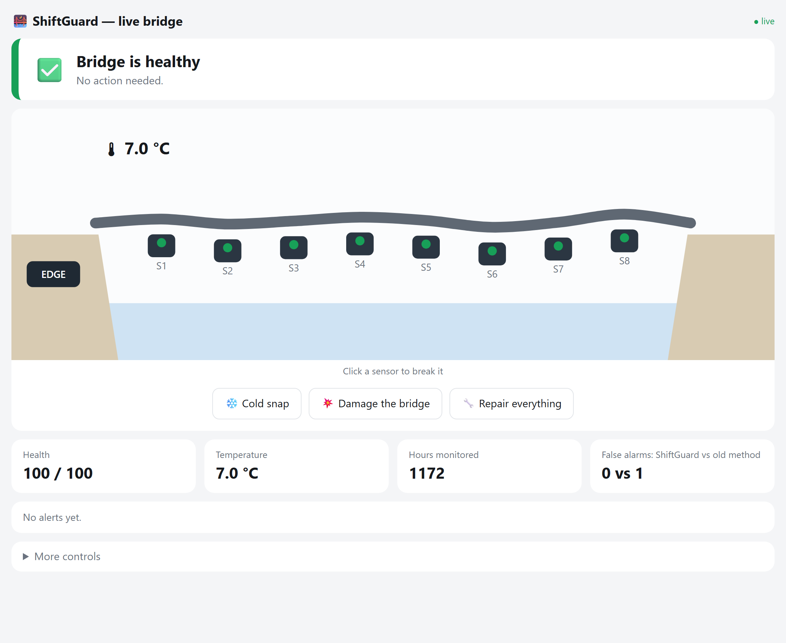
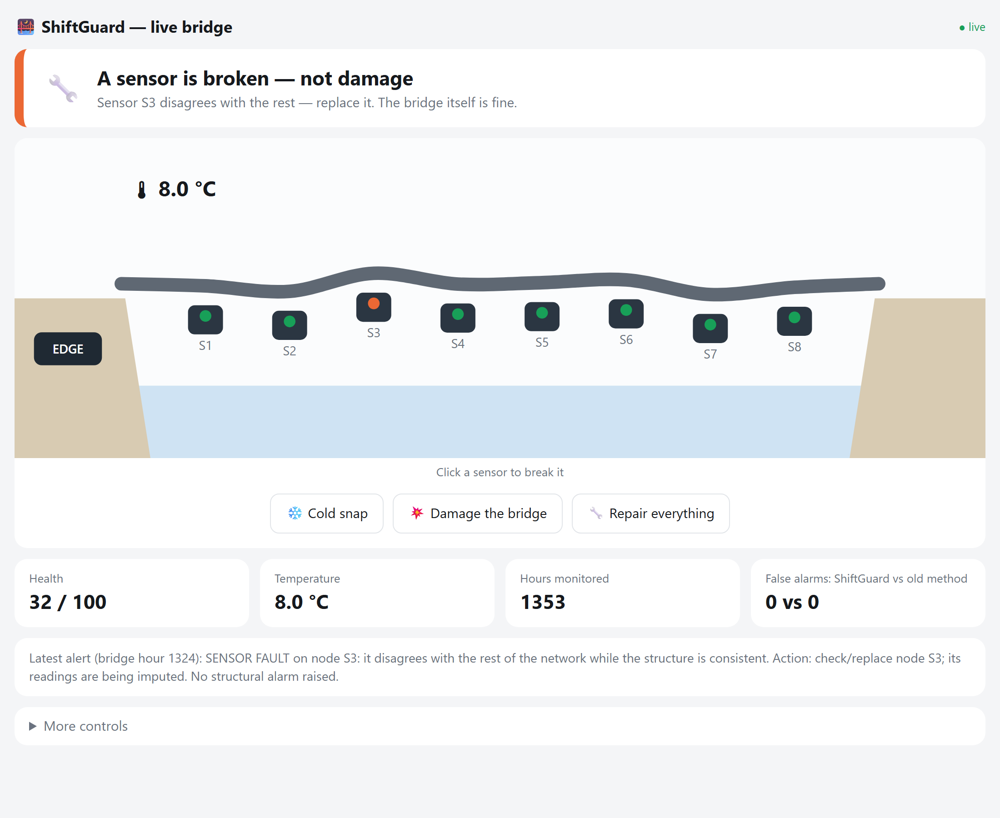
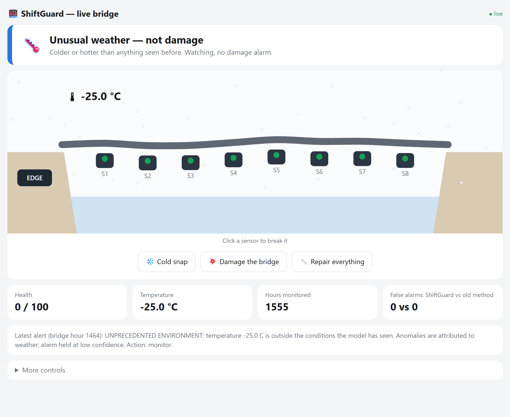
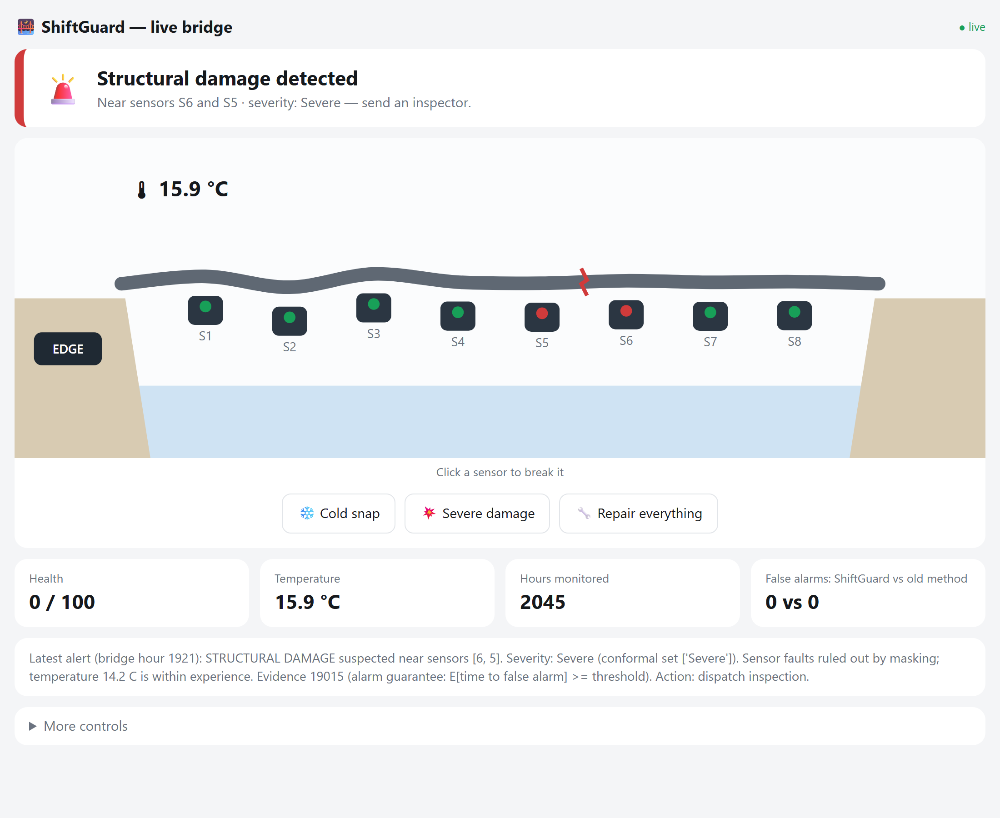
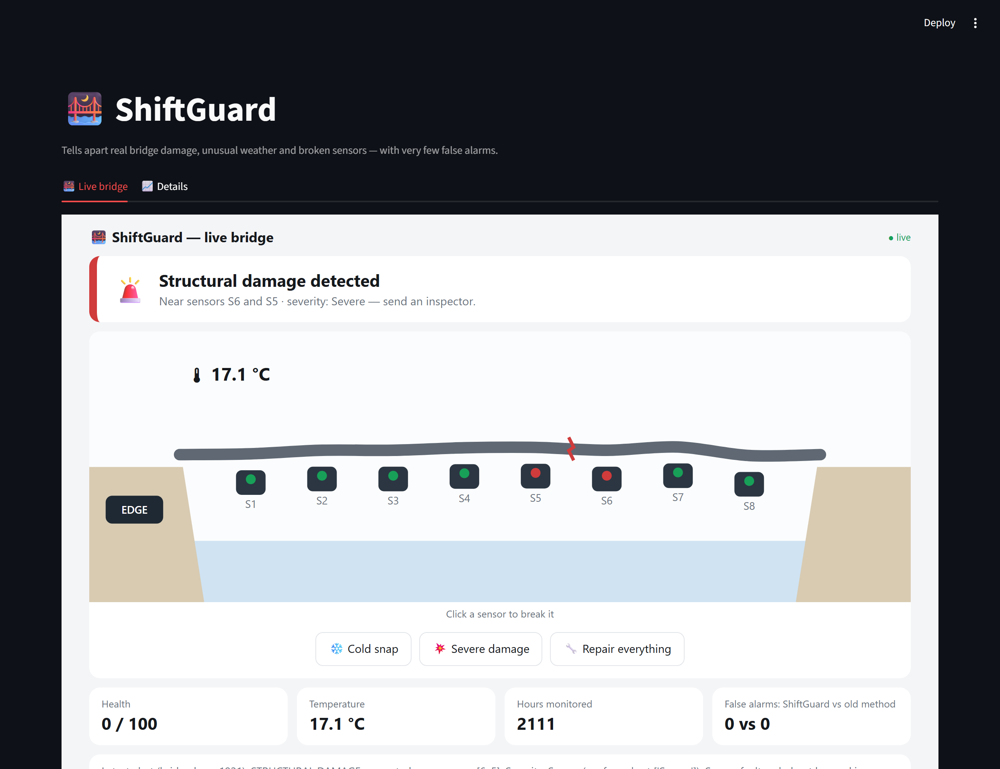

# 🌉 ShiftGuard

**A bridge-monitoring system that tells you *why* an alarm went off: real damage, unusual weather, or just a broken sensor. And it almost never cries wolf.**

8 virtual vibration sensors and a thermometer stream data from a simulated bridge over MQTT (the protocol real IoT sensors use). An AI model watches them around the clock, and a live web page shows what it decides.

| ✅ Healthy | 🔧 Broken sensor, not damage |
|---|---|
|  |  |
| **🌡️ Unusual weather, not damage** | **🚨 Real damage, located and graded** |
|  |  |

---

## The problem

- Most monitoring systems check every reading on its own and allow a small error, say 5 %.
- One reading per hour is 8,760 readings a year, so 5 % means **about 440 false alarms a year**. People stop trusting it.
- They also call **every** alarm "damage". But readings also change when it's freezing, or when a sensor breaks.

## How ShiftGuard works (in plain words)

1. **Listen.** Every hour, each sensor sends a 20-second vibration recording.
2. **Cross-check.** The model guesses each sensor's reading from the *other* sensors and the temperature.
   - One sensor disagrees with everyone else → **that sensor is broken.**
   - A whole region disagrees → **the bridge itself changed (damage).**
3. **Compare fairly.** Today is only compared with healthy days at a similar temperature.
4. **Add up evidence.** One odd hour does nothing. The alarm only rings when the evidence keeps piling up, which comes with a guarantee: on a healthy bridge, roughly one false alarm per 10,000 hours (about 14 months).
5. **Explain.** Every alarm says what it is: **damage** (where, and how bad), **broken sensor** (which one), or **unusual weather**. It's shown on the dashboard and can be emailed.

## Run it (3 commands)

You need Python 3.10–3.13. No hardware and no GPU.

```bash
python -m venv .venv && .venv\Scripts\activate      # macOS/Linux: source .venv/bin/activate
pip install -r requirements.txt
python run_demo.py
```

It trains a model the first time (about 1 minute), then opens the dashboard at **http://localhost:8501**.
The live bridge page is also at **http://localhost:8502/twin.html**.

## Things to try

| Do this | You should see |
|---|---|
| Click sensor **S3 → Make it noisy** | 🔧 *A sensor is broken: S3*. No damage alarm. |
| Click **❄️ Cold snap**, or set a very low temperature under *More controls* | Snow, then 🌡️ *Unusual weather, not damage* |
| Click **💥 Damage the bridge** (click again for severe) | A crack appears, then 🚨 *Damage near S5 and S6, severity Moderate/Severe* |
| Click **🔧 Repair everything** | ✅ back to healthy after a few hours |
| Open the **Details** tab | Evidence chart, alerts, and false alarms: ShiftGuard vs the old method |



## Results

| | False-alarm hours (ShiftGuard vs old method) | Damage found | Broken sensors called damage |
|---|---|---|---|
| Simulated year | **26 vs 347** | in under 4 h | **0 %** (old: 86 %) |
| Real Z24 bridge data | **10 vs 391** | severe only; moderate missed | **0.3 %** (old: 23 %) |

The real-data limit is stated openly: on the Z24 recordings, moderate damage is not caught yet. Full tables are in [`results/`](results/results.md) and in the paper.

## What's in the repo

```
run_demo.py          one command: broker + sensors + edge monitor + dashboard
shiftguard/          the method (model, conformal tests, attribution, severity)
iot/                 MQTT broker, virtual sensor nodes, edge monitor, Wokwi ESP32 node
dashboard/           Streamlit dashboard + live bridge page (twin.html)
scripts/             paper experiments, model training, screenshots
tests/               17 tests, including a real multi-process MQTT test
results*/            paper tables and figures (simulation and Z24)
paper/               IEEE paper (LaTeX + PDF)
review_deck/         Review-2 presentation
docs/GUIDE.md        full guide: Z24 data, Node-RED email, Wokwi, reliability, MQTT topics
```

Run the tests with `python -m pytest -q tests`.
Reproduce the paper's numbers with `python scripts/run_experiment.py --seeds 0 1 2`.

## Team

Hardik Grover, Advait Anand, Akash Kumar, Yograj. Supervisor: Dr. P. Saravanan.
Department of Computing Technologies, SRM Institute of Science and Technology.
